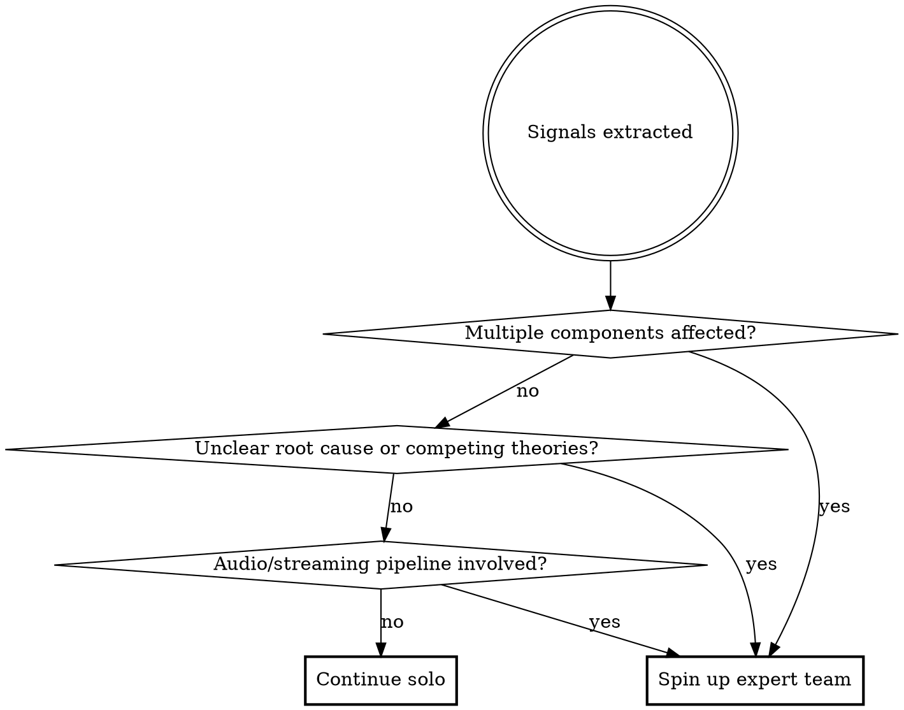

# Triage Music Assistant Issue

Triage the GitHub issue number provided by the user from the Music Assistant support repository.

## Context

- Issues are filed at: `music-assistant/support`
- Server source code is in the current working directory (the `music-assistant/server` repo)
- Logs are almost always attached as downloadable `.log` files on the issue

## Steps

### 1. Fetch the issue

```bash
gh issue view <number> --repo music-assistant/support --json number,title,body,labels,comments,state,author
```

Read the full body WITHOUT the AI analysis section and all comments carefully. Note:
- MA version (e.g. `2.7.8`)
- Install method (HA OS Addon / Docker / other)
- Music providers mentioned
- Player providers mentioned
- Description of the problem and reproduction steps

### 2. Download attached logs

Scan the issue body and every comment for `.log` file attachment URLs matching the pattern:
```
https://github.com/user-attachments/files/<id>/<filename>.log
```

For each URL found, download it to a temp file and strip ANSI color codes:
```bash
curl -sL "<url>" | sed 's/\x1b\[[0-9;]*m//g' > /tmp/ma-triage-<issue_number>.log
```

If multiple log files are attached, download all of them (append a counter to the filename).

### 3. Initial signal extraction

Use the Grep tool (not bash grep/rg) to scan downloaded logs for:
- Error/warning lines: pattern `ERROR|WARNING|CRITICAL|Traceback|Exception|raise `
- Logger names: pattern `\[music_assistant\.[^\]]+\]` to identify affected components
- ffmpeg errors: pattern `ffmpeg|FFmpeg|lavf|avcodec` (exclude INFO lines)

Extract:
- **Affected components**: logger names appearing in error lines
- **Exception class names**: e.g. `LoginFailed`, `SetupFailedError`, `AudioError`
- **Key error messages**: the actual error text
- **Timestamps** of the errors (to establish sequence of events)

### 4. Assess complexity and decide team strategy



**Continue solo** when the issue has a single clear error pointing to one component with an obvious code path. Skip to step 6.

**Spin up expert team** when the issue is complex. Proceed to step 5.

### 5. Spin up expert team

Use `TeamCreate` to create a team named `triage-<issue_number>`. Then spawn teammates using the `Agent` tool with `team_name` set to the team name.

Create tasks for each teammate using `TaskCreate`, then assign with `TaskUpdate`.

**Always spawn the Log Analyst.** Then add specialists based on what the signals reveal:

| Signal | Specialist to spawn | Focus |
|--------|---------------------|-------|
| Multiple providers in errors | One **Provider Investigator** per affected provider | Trace error in that provider's code, check recent git changes |
| Audio/streaming/ffmpeg errors | **Audio Pipeline Expert** | Trace through audio flow, ffmpeg integration, codec handling |
| Player protocol errors (airplay, sonos, dlna, cast, slimproto) | **Player Protocol Specialist** | Player state machine, protocol-specific quirks |
| HA integration / hass errors | **HA Integration Specialist** | Hass player bridge, entity handling, websocket flow |
| Unclear cause, multiple theories | 2-3 **Hypothesis Investigators** | Each investigates a different theory, they challenge each other's findings |

**Teammate prompts must include:**
- The issue number, title, and summary of the problem
- The path to the downloaded log file(s) in `/tmp/`
- The specific signals relevant to their role
- Instruction to use Grep/Read tools (not bash grep/rg) to search the codebase
- Instruction to reference specific `file:line` locations in findings
- The server codebase is in the current working directory

**Team coordination:**
- Teammates report findings via `SendMessage` to the lead
- Teammates should challenge each other's theories when root cause is ambiguous
- The lead synthesizes all findings into the final report
- When all tasks are complete, shut down teammates and clean up with `TeamDelete`

**Example spawn for a Qobuz + audio issue:**

```
TeamCreate: triage-1234

Agent (team_name: "triage-1234", name: "log-analyst"):
  "Analyze /tmp/ma-triage-1234.log for error patterns, timeline,
   and affected components. Focus on ERROR/WARNING/CRITICAL lines.
   Report findings to team lead."

Agent (team_name: "triage-1234", name: "qobuz-investigator"):
  "Investigate Qobuz provider errors in music_assistant/providers/qobuz/.
   Log signals show LoginFailed at <timestamp>. Trace the code path,
   check git log --oneline -20 for recent changes. Report root cause."

Agent (team_name: "triage-1234", name: "audio-expert"):
  "Investigate audio pipeline errors. Log shows ffmpeg codec errors
   at <timestamps>. Trace through music_assistant/helpers/audio.py
   and related streaming code. Report findings."
```

### 6. Search the server codebase (solo mode)

If continuing without a team, use the signals from step 3 to search the codebase.

Use `Grep` to find where exceptions or error messages are raised:
```
pattern: "<exception class or key error text>"
type: py
```

Use `Glob` to find relevant provider files:
```
pattern: "music_assistant/providers/<provider_name>/**/*.py"
```

Look for:
- Where the error is raised and why
- Whether there is a known code path that leads to it
- Any recent relevant changes: `git log --oneline -20 -- music_assistant/providers/<provider>/`

### 7. Search for duplicate issues

```bash
gh issue list \
  --repo music-assistant/support \
  --state all \
  --search "<2-3 key terms from the error or title>" \
  --limit 10 \
  --json number,title,state,labels
```

Run 1-2 searches with different keyword combinations. Look for issues with the same root cause, not just similar titles.

### 8. Output the triage report

Print the following to the console. **Do not post, comment, label, or close anything on GitHub.**

```
TRIAGE: #<number> - <title>

MA Version:    <version from issue>
Install:       <HA OS Addon | Docker | other>
Providers:     <music providers> / <player providers>
Team mode:     <solo | team with N specialists>

COMPONENT
  <affected provider or controller, e.g. music_assistant.providers.qobuz>

SEVERITY
  <crash | degraded | cosmetic | unknown>
  <one sentence explaining the impact>

LOG SIGNALS
  <timestamp> [<logger>] <key error line>
  <timestamp> [<logger>] <key error line>
  (include up to ~10 most relevant lines; omit routine INFO noise)

ROOT CAUSE ANALYSIS
  <file>:<line> - <explanation of what is happening and why>
  <additional context if needed>
  (in team mode: note which specialist identified this and any dissenting theories)

SUGGESTED FIX
  <concrete description of what change could fix it, or "Needs investigation">
  <file:line reference if applicable>

DUPLICATES
  #<number>: <title> (<state>) - <why it may be related>
  (or "None found")

MISSING INFORMATION
  <what additional info would help narrow this down, or "Sufficient">
  (e.g. "Verbose log with only the <provider> logger enabled would help")

SUGGESTED LABELS
  <comma-separated labels from the known vocabulary in labels.md>
```

## Important rules

- **Never post, comment, label, close, or modify anything on GitHub** - output is console-only
- If no log is attached, note this under MISSING INFORMATION and proceed with what is available
- If the log file is very large, still scan the full file for errors; do not truncate arbitrarily
- Be specific: always reference `file:line` when pointing to source code
- If the issue is clearly not a server bug (e.g. a frontend, companion app, or docs issue), state this explicitly under ROOT CAUSE ANALYSIS
- Use Grep and Read tools for file searching, not bash grep/rg
- Clean up the team (TeamDelete) after the triage report is complete
= IMPORTANT: If you are unsure about the root cause or the suggested fix, say "Needs investigation" rather than speculating. It's better to be honest about uncertainty than to provide incorrect information.
